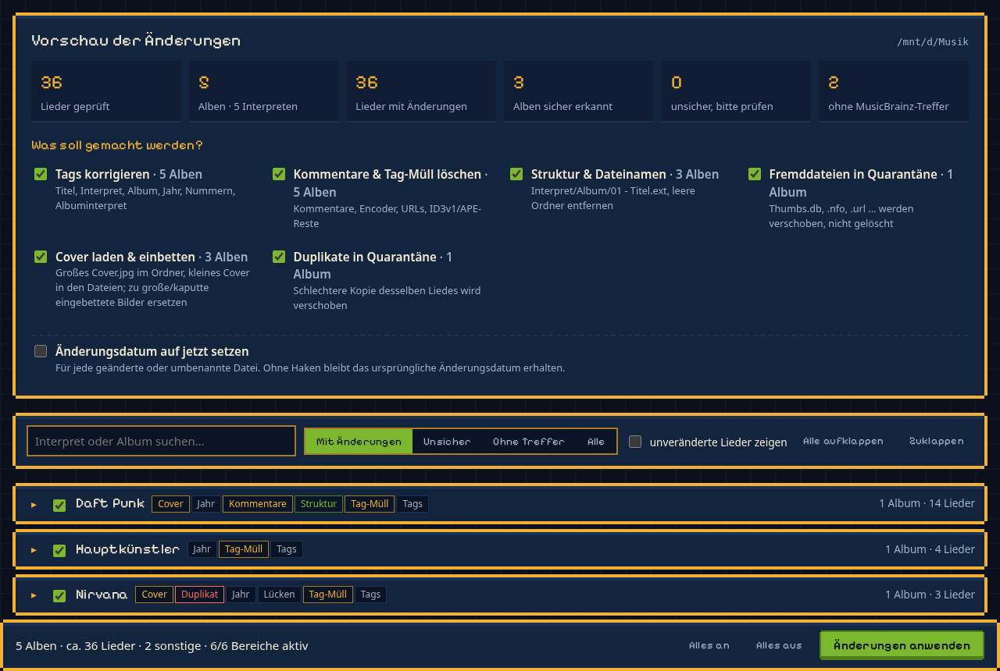
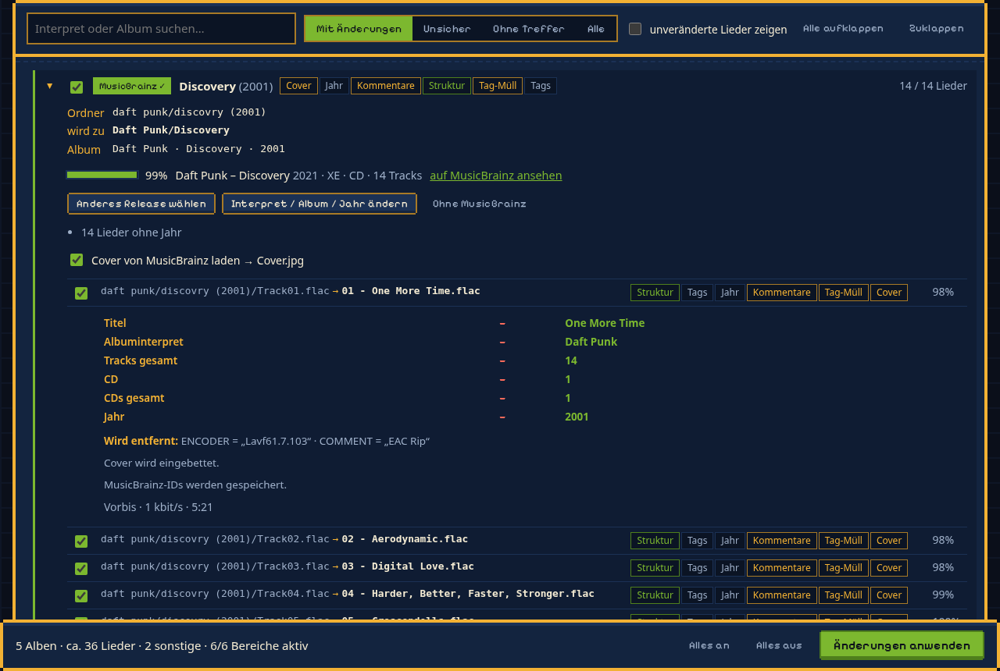
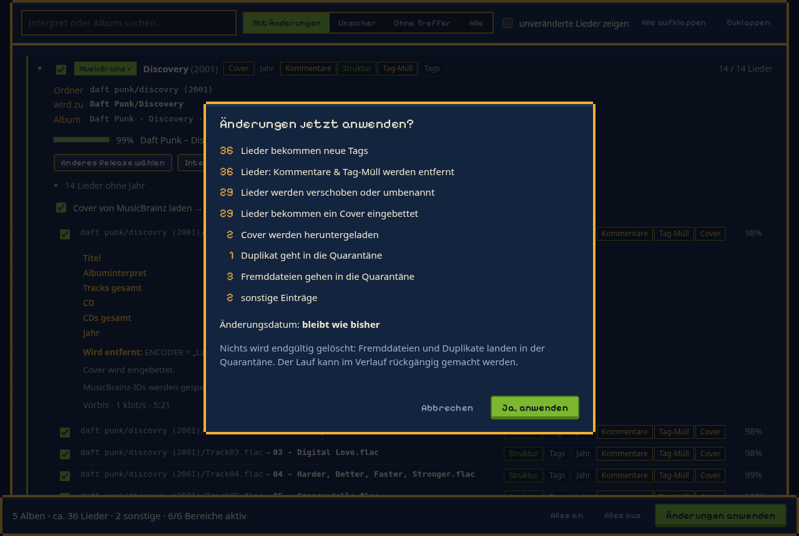
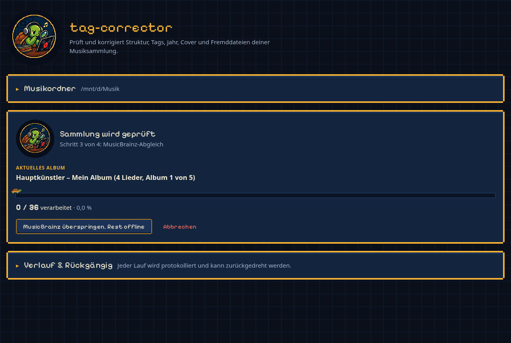
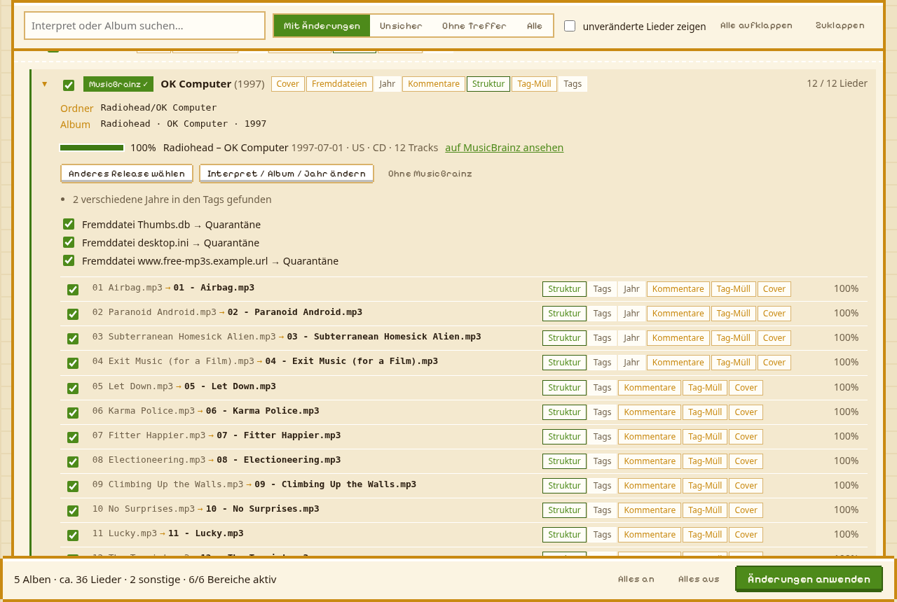

<p align="center">
  
</p>

<h1 align="center">tag-corrector</h1>

<p align="center">
  <strong>Bringt eine gewachsene Musiksammlung in Ordnung: saubere Ordner, vollständige Tags, passende Cover – mit Vorschau und Undo.</strong>
</p>

Ein lokales Tool mit Weboberfläche: Musikordner angeben, prüfen lassen, Vorschau kontrollieren, anwenden.
Jedes Album wird mit MusicBrainz abgeglichen, Dateien bekommen vollständige Tags und einheitliche Namen,
Cover werden geladen und eingebettet, Fremddateien und Duplikate wandern in eine Quarantäne. Vorher ändert
sich nichts – und jeder Lauf lässt sich komplett zurückdrehen.

## Funktionen

- 🗂️ **Einheitliche Struktur** – `<Interpret>/<Album>/01 - Titel.ext`, Mehrfach-CDs als `1-01 - Titel.ext`,
  lose Dateien und `CD1/`-Unterordner werden einsortiert, leere Ordner entfernt
- 🔎 **Tags von MusicBrainz** – Titel, Interpret, Album, Albuminterpret, Track/CD (mit Gesamtzahl), Jahr, Genre,
  Sampler-Flag und MusicBrainz-IDs; jedes Album wird einem Release zugeordnet, jedes Lied einem Track
- 🎯 **Vorsichtige Zuordnung** – Lieder werden nur bei ähnlichem Titel zugeordnet; doppelte Tracknummern oder
  schwache Treffer machen ein Album „unsicher“, unsichere Alben sind standardmäßig abgewählt
- 🖼️ **Cover** – großes `Cover.jpg` im Albumordner (fehlt es: Original vom Cover Art Archive), in den Dateien
  eine kleine Fassung (Standard max. 500 px); zu große, leere oder exotische eingebettete Bilder (GIF, BMP) werden ersetzt
- 🧹 **Tag-Müll weg** – Kommentare, Encoder, URLs, „Ripped by…“, ID3v1- und APE-Reste in MP3
- 📦 **Quarantäne statt Löschen** – Fremddateien (`Thumbs.db`, `.nfo`, `.url` …) und Duplikate landen in
  `_quarantaene/`; von doppelten Liedern bleibt die beste Kopie (verlustfrei vor höherer Bitrate),
  Live-, Remix- und Instrumental-Fassungen gelten nie als Duplikat
- 🎶 **Playlisten wandern mit** – `.m3u`/`.m3u8` im Musikordner werden beim Umbenennen automatisch angepasst
  (relative Pfade, `E:\…` und `/mnt/…`)
- 📁 **Deine Ordner bleiben** – steht ein Album im Ordner „Helge Schneider“ und lautet der Albuminterpret
  „Helge Schneider und meine kleine Band“, bleibt es dort
- ✏️ **Alles korrigierbar** – pro Album anderes Release wählen, eigene Suche, MusicBrainz-Link einfügen oder
  Interpret/Album/Jahr von Hand setzen; Interpreten, Alben und einzelne Lieder an- und abwählbar
- ✅ **Zusammenfassung vor dem Start** – konkrete Zahlen („29 Lieder werden umbenannt, 1 Duplikat geht in die
  Quarantäne …“) und eine Warnung, wenn unsichere Alben ausgewählt sind
- ↩️ **Rückgängig** – jeder Lauf schreibt ein Undo-Protokoll (inkl. Original-Tags und ersetzter Cover) und lässt
  sich unter „Verlauf & Rückgängig“ zurückdrehen
- 🩺 **Beschädigte Dateien** – werden mit Grund aufgelistet und nicht angefasst
- 🐢 **Schildkröten-Design** – Pixel-Look wie [yt-album-dl](https://github.com/perschkem/yt-album-dl), hell und dunkel
- 🪟 **WSL-freundlich** – Windows-Pfade wie `D:\Musik` funktionieren direkt

Unterstützte Formate: MP3, FLAC, M4A/AAC/ALAC, OGG, Opus, WMA, APE, WavPack, Musepack, WAV/AIFF.

## Screenshots

<p align="center">
  
</p>

<table>
  <tr>
    <td width="50%"><br>
      <sub><b>Album im Detail</b> – MusicBrainz-Treffer, neuer Ordner, alte → neue Dateinamen und Tags pro Lied</sub></td>
    <td width="50%"><br>
      <sub><b>Vor dem Anwenden</b> – was konkret passiert, in Zahlen</sub></td>
  </tr>
  <tr>
    <td width="50%"><br>
      <sub><b>Prüfen</b> – Schritt für Schritt, die Schildkröte läuft auf dem Balken mit</sub></td>
    <td width="50%"><br>
      <sub><b>Helle Variante</b> – folgt der Systemeinstellung</sub></td>
  </tr>
</table>

<sub>Screenshots mit Beispieldaten.</sub>

## Ablage

```
Musik/
  <Albuminterpret>/<Album>/01 - <Titel>.ext            ← Album
  <Albuminterpret>/<Album>/1-01 - <Titel>.ext          ← Album mit mehreren CDs
  <Albuminterpret>/<Album>/Cover.jpg                   ← großes Cover
  Various Artists/<Sampler>/01 - <Titel>.ext           ← Sampler ohne Hauptinterpreten
  _quarantaene/…                                       ← Fremddateien und Duplikate (nichts wird gelöscht)
  *.m3u / *.m3u8                                       ← Playlisten (bleiben im Wurzelordner)
```

Ordner ohne Jahr, Dateinamen ohne Interpret. Sampler: Gibt es einen Hauptinterpreten (mehr als die Hälfte der
Lieder), wird er Ordner und Albuminterpret, sonst `Various Artists`.

## Installation

Du brauchst: **Python 3.9 oder neuer** (mit `venv`) und **git** (zum Herunterladen des Programms). Alle Pakete
(Flask, mutagen, Pillow) installiert `start.sh` beim ersten Start automatisch in einen eigenen Ordner `.venv`.

Schritt-für-Schritt-Anleitungen: [Windows (mit WSL)](#windows-mit-wsl) · [macOS](#macos) · [Linux](#linux)

**Kurzfassung für Erfahrene:**

```bash
git clone https://github.com/perschkem/tag-corrector.git
cd tag-corrector
./start.sh               # → http://127.0.0.1:8765
```

> **Zugriff:** Ist das Repository privat, fragt `git clone` nach Benutzername und Passwort. Als Passwort dient dann
> ein GitHub-Token (GitHub → Settings → Developer settings → Personal access tokens), dein normales Passwort
> funktioniert dort nicht. Bei einem öffentlichen Repository entfällt das.

> Tipp: In den Anleitungen stehen Befehle in grauen Kästen. Kopiere sie einzeln (Markieren → Strg+C bzw. ⌘+C),
> füge sie im Terminal ein (Rechtsklick oder Strg+Umschalt+V bzw. ⌘+V) und drücke **Enter**.
> Wenn nach dem Passwort gefragt wird: Beim Tippen erscheinen keine Zeichen – das ist normal.

### Windows (mit WSL)

WSL („Windows-Subsystem für Linux“) ist ein kleines Linux, das Microsoft direkt in Windows mitliefert.
Das Programm läuft darin, du bedienst es ganz normal im Windows-Browser und es arbeitet direkt auf deinen
Windows-Laufwerken.

**1. WSL installieren (einmalig)**

1. Klicke auf **Start**, tippe `PowerShell`, klicke mit der rechten Maustaste auf **Windows PowerShell** und wähle
   **Als Administrator ausführen**.
2. Gib diesen Befehl ein und drücke Enter:
   ```powershell
   wsl --install
   ```
3. **Starte den PC neu**, wenn du dazu aufgefordert wirst.
4. Nach dem Neustart öffnet sich ein schwarzes Fenster „Ubuntu“ (falls nicht: Start → `Ubuntu` öffnen).
   Lege dort einen **Benutzernamen** (klein, ohne Leerzeichen, z.B. `anna`) und ein **Passwort** fest.

Ab jetzt passiert alles im **Ubuntu-Fenster**.

**2. Benötigte Programme installieren**

```bash
sudo apt update && sudo apt install -y python3 python3-venv git
```

**3. tag-corrector herunterladen und starten**

```bash
git clone https://github.com/perschkem/tag-corrector.git
```

```bash
cd tag-corrector && ./start.sh
```

Im Windows-Browser **http://127.0.0.1:8765** öffnen. Als Musikordner kannst du den Windows-Pfad eintragen
(z.B. `D:\Musik`) – er wird automatisch zu `/mnt/d/Musik`.

### macOS

1. **Terminal** öffnen (⌘+Leertaste, `Terminal` tippen, Enter).
2. Entwicklerwerkzeuge installieren (bringt Python 3 und git mit; ein Fenster fragt nach Bestätigung):
   ```bash
   xcode-select --install
   ```
3. Herunterladen und starten:
   ```bash
   git clone https://github.com/perschkem/tag-corrector.git
   cd tag-corrector && ./start.sh
   ```
4. Im Browser **http://127.0.0.1:8765** öffnen. Musikordner z.B. `/Users/anna/Music`.

### Linux

```bash
# Ubuntu, Debian, Linux Mint
sudo apt install -y python3 python3-venv git
```

```bash
# Fedora
sudo dnf install -y python3 git
```

```bash
# Arch, Manjaro
sudo pacman -S --needed python git
```

Dann:

```bash
git clone https://github.com/perschkem/tag-corrector.git
cd tag-corrector && ./start.sh
```

### Später starten, beenden, aktualisieren

- **Starten:** Terminal (unter Windows: Start → `Ubuntu`) öffnen, dann
  ```bash
  cd tag-corrector && ./start.sh
  ```
  und im Browser http://127.0.0.1:8765 öffnen.
- **Beenden:** Im Terminal **Strg+C** drücken (auch auf dem Mac Strg, nicht ⌘). Ein laufender Vorgang wird dabei
  abgebrochen – bereits erledigte Schritte stehen im Undo-Protokoll.
- **Aktualisieren:**
  ```bash
  cd tag-corrector && git pull && ./start.sh
  ```
  Neue Pakete installiert `start.sh` dabei automatisch nach.

### Probleme?

| Problem | Lösung |
|---|---|
| `python3: command not found` bzw. `Befehl nicht gefunden` | Schritt „Benötigte Programme installieren“ wiederholen |
| `ensurepip is not available` / `venv` fehlt | `sudo apt install -y python3-venv`, dann den Ordner `.venv` löschen und `./start.sh` erneut starten |
| Browser zeigt „Seite nicht erreichbar“ | Läuft `./start.sh` noch im Terminal? Fenster offen lassen. Adresse genau `http://127.0.0.1:8765` |
| „Address already in use“ beim Start | Läuft der tag-corrector schon? Sonst anderen Port wählen: `./start.sh --port 8766` |
| Ordner wird nicht gefunden | Unter WSL liegen Windows-Laufwerke unter `/mnt/<buchstabe>/`, z.B. `D:\Musik` → `/mnt/d/Musik` |
| Die Zuordnung eines Albums ist falsch | Album aufklappen → **Anderes Release wählen**, MusicBrainz-Link einfügen oder **Ohne MusicBrainz** |
| MusicBee meldet beim Einlesen „Unable to process file …, link artwork“ | Liegt nicht an den Dateien: MusicBee schließen, dessen Bibliotheksordner beiseitelegen (Playlisten vorher sichern) und die Sammlung neu einlesen |
| Etwas ging schief | **Verlauf & Rückgängig** → den Lauf zurückdrehen |

## Benutzung

1. **Prüfen** – Musikordner eintragen (zum Ausprobieren unter „Nur Teilordner prüfen“ z.B. einen Interpreten)
   und **Sammlung prüfen**. Das Programm liest alle Dateien und gleicht jedes Album mit MusicBrainz ab
   (ca. 1–2 s pro Album; Ergebnisse werden gespeichert, ein zweiter Lauf geht schnell).
   **MusicBrainz überspringen** erledigt den Rest offline aus vorhandenen Tags und Ordnernamen.
2. **Vorschau** – oben die Bereiche wählen (Tags, Tag-Müll, Struktur, Fremddateien, Cover, Duplikate), darunter
   Interpret → Album → Lied mit allen geplanten Änderungen. Filter „Unsicher“ und „Ohne Treffer“ zeigen, was
   einen Blick braucht. Unsichere Alben sind abgewählt.
3. **Anwenden** – die Zusammenfassung zeigt, was konkret passiert. „Änderungsdatum auf jetzt setzen“ stempelt
   jede geänderte Datei mit dem aktuellen Datum (damit Player wie MusicBee die Änderungen sicher bemerken);
   ohne Haken bleibt das ursprüngliche Datum erhalten.
4. **Rückgängig** – unter **Verlauf & Rückgängig** jeden Lauf zurückdrehen: Tags, eingebettete Cover,
   Dateinamen, Ordner und Playlisten.

> **Tipp:** Vor dem ersten großen Lauf eine Sicherung der Sammlung anlegen und mit einem Teilordner anfangen.

## Konfiguration

Alle Einstellungen stehen in der Oberfläche (Bereich **Erweitert**) und werden beim Prüfen gespeichert:

| Einstellung | Standard | Bedeutung |
|---|---|---|
| Quarantäne-Ordner | `_quarantaene` | Ziel für Fremddateien und Duplikate, im Wurzelordner |
| Dateiname für geladene Cover | `Cover.jpg` | Name des großen Bildes im Albumordner |
| Max. Größe eingebetteter Cover | `500` px | längste Kante des Bildes in den Dateien |
| Erlaubte Dateien im Albumordner | `folder.jpg, cover.jpg, front.jpg, back.jpg …` | alles andere gilt als Fremddatei |
| Erlaubte Unterordner für Bilder | `scans, artwork, covers, booklet` | z.B. `Scans/front.jpg` bleibt erhalten |
| Nur im Wurzelordner erlaubt | `*.m3u, *.m3u8, *.pls, *.wpl, *.xspf` | Playlisten; an jeder anderen Stelle Fremddatei |

Gespeichert wird in `~/.cache/tag-corrector/`: `settings.json`, der MusicBrainz-Zwischenspeicher
(`musicbrainz.sqlite`, `covers/`) und die Undo-Protokolle (`undo/`).

| Startoption / Variable | Standard | Bedeutung |
|---|---|---|
| `--host` / `--port` | `127.0.0.1` / `8765` | Webserver, z.B. `./start.sh --port 8766` |
| `TAGCORRECTOR_UA` | `TagCorrector/1.0 (…)` | User-Agent für MusicBrainz (gern mit eigener Kontaktadresse) |

## Projektstruktur

```
tag_corrector/
  app.py          Flask-Server, API und Hintergrund-Jobs (Prüfen, Anwenden, Rückgängig)
  planner.py      Scannen, Gruppieren, MusicBrainz-Abgleich, Änderungsplan pro Album
  executor.py     Plan ausführen mit Undo-Protokoll, Playlisten anpassen, Rückgängig machen
  tags.py         Tags lesen/schreiben für alle Formate (mutagen), eingebettete Bilder
  mb.py           MusicBrainz- und Cover-Art-Archive-Abfragen mit Zwischenspeicher
  util.py         Normalisierung, Ähnlichkeit, Dateinamen, Bilder verkleinern (Pillow)
  static/         Weboberfläche (HTML/CSS/JS ohne Build-Schritt), Pixel-Schrift, Schildkröten-Bilder
tools/
  make_testdata.py  absichtlich chaotische Test-Sammlung erzeugen
docs/             Logo und Screenshots für diese Seite
```

## Entwicklung

```bash
.venv/bin/python tools/make_testdata.py /tmp/testmusik    # Test-Sammlung erzeugen (braucht ffmpeg)
./start.sh --port 8766                                     # zweite Instanz zum Ausprobieren
```

Das Design folgt [yt-album-dl](https://github.com/perschkem/yt-album-dl) (`DESIGN.md` dort): Nachtblau/Gold,
Pixelify Sans (lokal eingebunden, OFL-Lizenz in `static/fonts/`), Pixel-Rahmen, sachliche Texte.

## Hinweis

Das Programm verändert Dateien in deiner Musiksammlung. Es löscht nichts endgültig und jeder Lauf ist umkehrbar,
trotzdem gilt: vorher eine Sicherung anlegen. Metadaten stammen von [MusicBrainz](https://musicbrainz.org)
(CC0), Cover vom [Cover Art Archive](https://coverartarchive.org); bitte deren Nutzungsbedingungen beachten.
